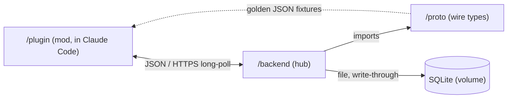
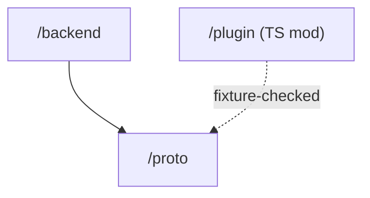
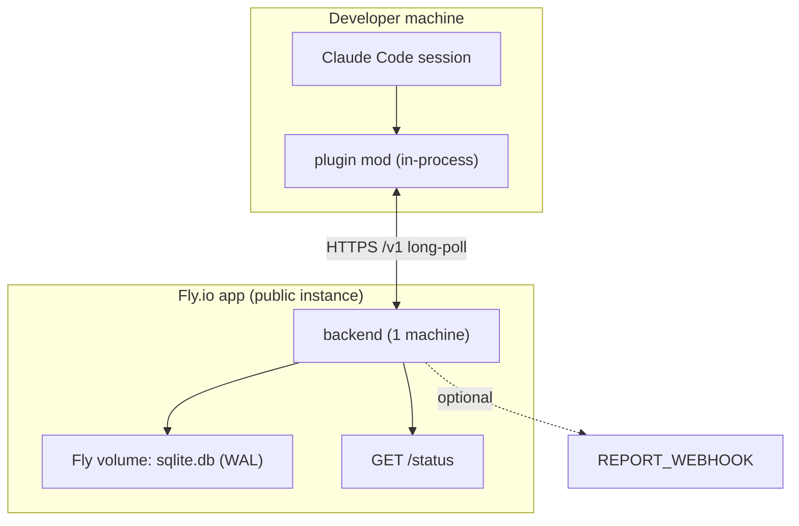
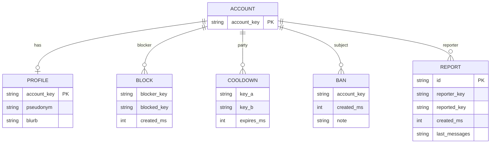

# Architecture Spine — Claude Think-Time Chat Roulette

## Design Paradigm

**Hub-and-spoke relay.** One authoritative backend (the hub) holds all queue, pairing, and
session state in memory. Mod clients (spokes) render and relay only — they hold no
authoritative state and never talk to each other. A spoke recovers from any fault by
re-polling on its handle or re-announcing with `hello`.

> **Revision 2026-10-17 (mods pivot).** The spoke was a Go companion TUI in a terminal pane
> (websocket, transcript watching, tmux / new-window placement). It is now the plugin's Claude
> Code **mod**, in-process, talking HTTPS long-poll. Epics 1–3 built the companion; Epic 7
> replaces it. See `sprint-change-proposal-2026-10-17.md`.

| Unit | Role | Directory |
| --- | --- | --- |
| `plugin` | Claude Code plugin whose TypeScript mod is the spoke: think-time signal, HTTPS client, chat UI, account key, first-run gate. | `/plugin` |
| `backend` | Go service: FIFO queue, pairing, relay, policy enforcement, persistence, `/v1` client API. The hub. | `/backend` |
| `proto` | Shared Go module: every wire message type + the protocol-version constant + golden JSON fixtures. | `/proto` |



Dependency direction: `backend → proto`. The mod's TypeScript wire types are checked against
`/proto`'s golden fixtures (no code import). Nothing depends on `plugin`. `proto` depends on
nothing.

## Invariants & Rules

`[ADOPTED]` marks a call inherited verbatim from the finalized PRD; untagged ADs are this
spine's own.

### AD-1 — Hub-and-spoke, backend authoritative

- **Binds:** all v1 units
- **Prevents:** divergent state ownership; peer-to-peer paths that bypass moderation
- **Rule:** all queue / pairing / active-session state lives in the backend and only there.
  Mod clients hold no authoritative state and never communicate with each other. A client's
  only recovery action is to re-poll on its handle or re-announce with `hello` (AD-17).

### AD-2 — Backend enforces all matching & moderation policy

- **Binds:** `backend`, `plugin`
- **Prevents:** the open-source client becoming safety-load-bearing; two enforcement points drifting
- **Rule:** identity acceptance, eligibility (block / cooldown / ban), rate limiting, and
  keyword filtering are decided only by the backend. The mod renders outcomes and never
  gates on them locally. **Carve-out:** the first-run 18+ / safety gate (PRD UJ-5, FR43–44)
  is a *local precondition* in the mod — no server round-trip, no server-side
  attestation record; the mod simply does not `hello` until it is cleared.
  Rate-limit note: involuntary re-enqueues (AD-16) and grace resumes (AD-17) do not count
  against a key's match-rate limit — only user-initiated new matches do.

### AD-3 — Wire protocol: versioned JSON over HTTPS, defined once in `/proto`

- **Binds:** `proto`, `plugin`, `backend`
- **Prevents:** client / server message-schema drift; an under-specified contract
- **Rule:** every request body, response body, and event is JSON matching a type declared in
  `/proto`; no message shape exists elsewhere. `/proto` emits golden JSON fixtures for every
  type and the mod's TypeScript declarations must round-trip them in `claude plugin test`.
  Envelope: `{ "type": <snake_case>, "v": <int>, ...payload }`. Transport (amended 2026-10-17):
  - `POST /v1/hello` → `welcome` (`handle`) or `please_update`
  - `GET /v1/events?after=<seq>` → long-poll held up to ~20s → ordered `{seq, ...msg}` list
    (empty on timeout) — see AD-19
  - `POST /v1/send` → one client→server message; protocol errors answer with an `error` body
  - the handle travels in a request header; the account key appears only in `hello`
  The v1 set is:
  - **client→server:** `hello` (protocol version, account key, optional `session_id` for a
    grace resume), `ready`, `busy`, `chat_msg` (`client_msg_id`, `text`), `leave`, `block`,
    `report` (`last_n`), `profile_put` (`pseudonym`, `blurb`; empty = clear), `forget_me`,
    `note_put` (`text`). (`heartbeat` removed 2026-10-17 — the AD-17 lease replaces it.)
  - **server→client:** `welcome` (`handle`), `queued`, `matched` (`session_id`, peer
    `pseudonym`/`blurb`, `opener` text), `chat_msg` (`text`), `session_ended`, `blocklist`,
    `profile_ack`, `error` (`code`, `msg`), `please_update`
  - `chat_msg` is **not** echoed to the sender; the mod renders its own outbound
    optimistically keyed by `client_msg_id`. `please_update` is its own type, never an `error`
    code.

### AD-4 — One session ID; every chat exit is one identical `session_ended`  `[ADOPTED]`

- **Binds:** `proto`, `plugin`, `backend`
- **Prevents:** leaking which exit occurred — violates PRD FR19/FR21
- **Rule:** the backend mints exactly one `session_id` at pairing and returns it in the
  `matched` message for **every** chat. Peer leave, block, report, disconnect, and
  model-returned all terminate a chat with a single `session_ended` message carrying **no
  cause field and no session_id**. The mod always renders the same "your Claude is
  back" copy, and decides whether to offer "copy session ID" from its *local* persist state,
  never from message contents. On `leave` / burst-end the backend stops relaying at once:
  messages already received are delivered, later ones dropped, `session_ended` is the peer's
  last message.

### AD-5 — Protocol version negotiated on hello

- **Binds:** `plugin`, `backend`
- **Prevents:** a stale installed plugin breaking against a newer deployed backend
- **Rule:** the mod sends its protocol version in the `hello` body. The backend accepts the
  current and previous minor; older gets a single `please_update` as the `hello` response and
  no handle. Any breaking wire change bumps the minor.

### AD-6 — The mod alone determines think-time boundaries  `[ADOPTED, amended 2026-10-17]`

- **Binds:** `plugin`, `backend`
- **Prevents:** two components holding two notions of when a chat should end
- **Rule:** only the mod decides busy-vs-back, from Claude Code's **main-loop** turn events —
  `turn.start` (with `e.agentId` undefined) → `ready`, its `turn.complete` → `busy`; subagent
  turns are ignored, and one main-loop turn spans its tool calls (PRD FR3). It expresses this to
  the backend solely as `ready` / `busy`. The backend never infers session state from timing.
  _(Was: the companion tailing the session transcript file.)_

### AD-7 — The plugin is the whole client  `[amended 2026-10-17]`

- **Binds:** `plugin`
- **Prevents:** an out-of-process component, a binary release matrix, and placement logic that
  differs per terminal
- **Rule:** the plugin ships no binary and spawns no process. Its mod runs in-process for the
  session's life. State that must survive a hot reload (handle, last `seq`, chat view state)
  lives in `$.state`, never in module variables; nothing chat-related is written to `$.store`
  or disk (AD-10). _(Was: `SessionStart` spawns the companion detached, launch-only.)_

### AD-8 — Single-writer state; it owns the queue, pairings, and live policy

- **Binds:** `backend`
- **Prevents:** FIFO races, double-matching, policy lost across restarts, split read/write paths
- **Rule:** exactly one goroutine mutates queue, pairing, and in-memory policy state, driven
  by a channel it consumes; all connection handlers interact with it only by sending on that
  channel. On startup it loads every block, cooldown, and ban from SQLite; thereafter SQLite
  is a **write-through durable mirror** and no other code path reads policy for a matching
  decision. It owns pairing teardown. **Matching (FR7–FR9):** scan from the queue head, pair
  the head with the first eligible successor (not blocked / on cooldown / banned / self); if
  none within a bounded scan, the head waits. **Cooldown (FR34):** a cooldown row is written
  only after a pairing lasts ~1 minute or both sides send ≥1 message — never at pairing time,
  and never for a pairing torn down inside the AD-17 grace window with no exchange.

### AD-9 — Profile: the backend copy is canonical

- **Binds:** `plugin`, `backend`
- **Prevents:** two sources of truth for the pseudonym / blurb
- **Rule:** the mod edits a local draft and sends `profile_put` on change (full
  replace, not a patch). The backend stores the canonical profile and is the only origin of
  the pseudonym / blurb delivered to a peer in `matched`. `forget_me` drops all rows keyed to
  the account key (PRD NFR4).

### AD-10 — Data-at-rest rule  `[ADOPTED]`

- **Binds:** `backend`
- **Prevents:** any persistence path that violates PRD FR15 / NFR1
- **Rule:** message content is never written to disk or logs. Sole exception: a `report` row
  (the last N messages of that one chat), deleted once actioned. Persisted data is limited
  to: profiles, block lists, cooldown rows, bans, account-key rows, report rows, and a
  `schema_version` row. Empty-queue notes and rate-limit counters live in memory only.

### AD-11 — Account key: presented, not verified  `[ADOPTED]`

- **Binds:** `plugin`, `backend`
- **Prevents:** reliance on a Claude-account identifier the platform does not expose
- **Rule:** the mod reads or creates a random UUID at `os.UserConfigDir()/claudingtin/account-key`
  (the path the companion used, so existing keys carry over) via `$.fs`, mode 0600, outside the
  plugin directory, and sends it in `hello` only. The backend treats it as opaque and
  authoritative with no verification. (PRD OQ-3; evasion accepted.)

### AD-12 — Configuration: backend env, client plugin userConfig

- **Binds:** `plugin`, `backend`, deployment
- **Prevents:** config drift between the Fly instance and self-hosted deploys; ad-hoc client
  config files
- **Rule:** no config files of our own. The backend reads environment variables only: `PORT`,
  `DB_PATH`, `KEYWORDS_PATH`, optional `REPORT_WEBHOOK`. The mod reads Claude Code plugin
  `userConfig` only: `backendUrl` (default: the public instance) and `persist` (default `true`).

### AD-13 — No admin HTTP surface; admin is a CLI on the same binary

- **Binds:** `backend`
- **Prevents:** an admin attack surface (and its auth burden) in v1
- **Rule:** the only HTTP endpoints are the `/v1` client API (`hello`, `events`, `send`) and
  `GET /status`. Maintainer
  actions (`backend ban`, `backend reports`, …) are subcommands writing the shared SQLite
  file. The `serve` process re-reads bans on a short interval (~10s) and on `SIGHUP`;
  `backend ban` writes the row and sends `SIGHUP` via pidfile when present — so FR40
  "immediately" means within that interval. SQLite is opened WAL + `busy_timeout` for the
  two-process access.

### AD-14 — Fail-open: never block or error the Claude Code session  `[ADOPTED, amended 2026-10-17]`

- **Binds:** `plugin`
- **Prevents:** the plugin degrading the host session (PRD FR6, NFR6, NFR8)
- **Rule:** no mod hook awaits the network or throws into the host; render and turn hooks
  return `next(e)` promptly and all backend I/O runs in background tasks with bounded
  timeouts. Any failure — unreachable backend, bad URL, malformed response, API mismatch — is
  swallowed into a calm offline state; Claude Code proceeds untouched and no error surfaces.

### AD-15 — Content sanitization has one owner per direction

- **Binds:** `backend`, `plugin`
- **Prevents:** mod and backend each assuming the other sanitizes — a safety-path divergence
- **Rule:** the **backend** is the single point that inerts/strips links, enforces message
  length caps, and rejects oversized or non-text frames on ingest — before relay and before
  the keyword filter. The **mod** renders all peer text only through `Text` with control characters stripped —
  never through `Markdown`, `Link`, or `Code` — so no remote markup, no control sequences, no
  link activation. (PRD FR14, NFR11; addendum safety keystone.)

### AD-16 — The backend owns queue membership and the FR20 requeue

- **Binds:** `plugin`, `backend`
- **Prevents:** double-enqueue, one key matched to two peers, spinner-forever, FR36 ambiguity
- **Rule:** the mod only sends `ready` / `busy`; the backend translates that into queue
  membership and owns silently re-enqueuing a still-busy user after any session end (PRD
  FR20). **One active handle per account key:** a second `hello` for a key already holding a
  handle supersedes it — the prior handle's queue gets `session_ended`, then its requests get
  410. A superseded mod stays quiet until its next `turn.start` (no `hello` ping-pong between two
  Claude Code sessions sharing a key). This is how FR36 "exactly one concurrent session" is met.

### AD-17 — Reconnect grace window, driven by a lease

- **Binds:** `backend`, `plugin`
- **Prevents:** a wifi blip destroying a pairing and burning a cooldown; forced-requeue griefing
- **Rule:** a handle is *connected* while a `GET /v1/events` is in flight or for ~5s after one
  ends (the lease). A lapsed lease is a spoke disconnect: the backend holds the pairing for a
  short grace window (~10s). A poll on the same handle, or a `hello` presenting the same
  `account key` + `session_id`, inside the window resumes it. On expiry the peer gets
  `session_ended` and both sides are re-enqueued if still busy. Grace resumes and involuntary
  requeues are exempt from rate limiting (AD-2).

### AD-18 — Forward-only embedded schema migrations

- **Binds:** `backend`
- **Prevents:** an ad-hoc schema drifting across backend releases on a long-lived volume
- **Rule:** the backend embeds ordered SQL migrations and applies all pending ones on
  startup, gated by the `schema_version` row. No down-migrations in v1. (The data-at-rest
  parallel to AD-5.)

### AD-19 — Ordered, acknowledged event delivery  `[new 2026-10-17]`

- **Binds:** `backend`, `plugin`
- **Prevents:** ordering races between separate client channels (`session_ended` vs `chat_msg`
  vs `matched`); silent relay loss on a full buffer
- **Rule:** each handle has exactly one bounded event queue with a monotonic `seq`. Every
  server→client message for that handle flows through it in hub order. The client acknowledges
  by passing `after=<last seq>`; delivery is at-least-once and the mod de-duplicates by `seq`.
  Overflow ends the session with `session_ended` rather than dropping events.

### AD-20 — No surface, no queue  `[new 2026-10-17]`

- **Binds:** `plugin`
- **Prevents:** ghost matches — a peer paired with someone who cannot see the chat
- **Rule:** the mod sends `ready` only while its UI is drawn on an attached surface. Where mod
  UI does not draw (`claude -p`, Agent SDK, VS Code extension chat panel, Remote-Control-only
  viewing, cloud, Desktop WSL) it never queues. This is the accepted reach limitation of PRD FR6.

**Dependency direction** (who may import / depend on whom):



Nothing may depend on `plugin`; `proto` depends on nothing.

## Consistency Conventions

| Concern | Convention |
| --- | --- |
| Naming | Go packages lowercase, no underscores. Wire types are `PascalCase` structs in `/proto` with a `snake_case` `type` discriminator. SQLite tables `snake_case` plural. |
| Data & formats | IDs are UUIDv4 strings. `session_id` is an opaque, unguessable string minted by the backend (PRD FR26). Timestamps are Unix epoch milliseconds (`int64` on the wire, `INTEGER` in SQLite). Client-facing errors are an `error` message — never a 5xx or a dropped request, except the AD-5 `please_update` and the AD-16 410 on a superseded handle. |
| State & cross-cutting | All queue / pairing / policy mutation goes through the AD-8 single writer. Message relay is in-memory only (AD-10). Logs are structured JSON to stdout, no message content, no account keys. Config via env only (AD-12). No authentication in v1 (AD-11). Transient IP data (rate-limiting only) is in-memory, never persisted or logged (PRD NFR2). The account key never appears in any server→client message a peer receives (PRD NFR3). |

## Stack

_Seed — verified current 2026-09-01; the code owns this once it exists. Pin exact patch versions at project init._

| Name | Version |
| --- | --- |
| Go | 1.27.x |
| Claude Code (mods API) | ≥ 2.1.301 — `claude-code.d.ts` is the authority; early access |
| Mod language | TypeScript / TSX loaded directly by Claude Code (no build step) |
| modernc.org/sqlite (pure-Go, no cgo) | v1.57.0 |
| Public instance | Fly.io — `shared-cpu-1x`, one machine, one volume, free shared IPv4 |
| Self-host | Docker + `docker-compose.yml` (same image) |

_Fly.io has had no free tier since 2024 — the public instance carries a small real bill (~$5–10/mo). Use the free shared IPv4, not a dedicated one._

## Structural Seed

### Containers & environments



- **Public instance:** one Fly machine + one volume; TLS at Fly; single-instance by design
  (one SQLite file, no horizontal scale in v1). Volume snapshots are the backup posture.
- **Self-host:** identical image via `docker compose up`; operator supplies a volume mount,
  env vars, and their own TLS reverse proxy.
- **Release flow:** CI publishes the backend container image. The plugin ships as source (no
  binaries); CI runs `claude plugin validate --strict plugin` and `claude plugin test plugin`.
  The README pins the minimum Claude Code version.

### Persisted entities (SQLite)



The FIFO queue, active pairings, relayed messages, empty-queue notes, and rate-limit
counters are in-memory only and die with the process (AD-1, AD-10).

### Source tree

```text
claudingtin/
  proto/             # shared Go module: wire message types + PROTOCOL_VERSION + golden fixtures
  backend/
    cmd/             # `backend serve`, `backend ban`, `backend reports`
    migrations/      # embedded, ordered, forward-only (AD-18)
  plugin/
    .claude-plugin/  # plugin.json (userConfig: backendUrl, persist)
    hooks/           # hooks.json + the mod (register.tsx, …) and its tests
    types/           # PluginState declarations
  deploy/            # Dockerfile, docker-compose.yml, fly.toml, keywords.txt
  .github/workflows/ # backend build + image release; mod validate/test
```

## Capability → Architecture Map

| PRD area | Lives in | Governed by |
| --- | --- | --- |
| F1 Think-time detection & session lifecycle | `plugin` (mod) | AD-6, AD-7, AD-14, AD-20 |
| F2 FIFO matching & queue | `backend` | AD-1, AD-8, AD-16 |
| F3 The chat surface | `plugin` (mod) | AD-2, AD-3, AD-10, AD-15 |
| F4 Exit convention & disconnect | `proto` + `plugin` + `backend` | AD-4, AD-16, AD-17, AD-19 |
| F5 Persist & commitment ramp (session IDs) | `plugin` (userConfig toggle) + `backend` (mints ID) | AD-4, conventions |
| F6 Tiny profile | `plugin` (edit) + `backend` (canonical) | AD-9 |
| F7 Openers | `backend` (selects, sends text in `matched`) | AD-1, AD-3 |
| F8 Block, cooldown, rate limiting | `backend` | AD-2, AD-8 |
| F9 Reporting & moderation | `backend` (report row + CLI) + `backend` keyword filter | AD-10, AD-13, AD-15 |
| F10 Onboarding, age gate, safety disclosure | `plugin` (first-run, local) | AD-2 carve-out, AD-11 |
| F11 Idle experience (empty-queue note) | `backend` (holds note) + `plugin` (offers) | AD-1, AD-10, AD-16 |
| NFR6/NFR8 fail-open | `plugin` | AD-14, AD-20 |
| NFR15 Status view | `backend` `GET /status` | AD-13 |

## Deferred

- **v2 reconnect webapp and its datastore** — separate initiative; this spine only avoids
  precluding it (session IDs are already opaque and backend-issued).
- **Pull-in matching, interest tags** — post-v1 matching-layer features; no v1 hook needed.
- **Multi-instance / horizontal scale, self-hosted pool federation** — single-instance is a
  deliberate v1 constraint (one SQLite file); revisit past hobby scale.
- **Turn-event edge cases** (interrupted turns, `turn.complete` reasons, `/clear` / `/resume`
  not re-firing `session.start`) — implementation detail behind AD-6.
- **Rate-limit numeric values, keyword-list contents, grace-window and cooldown exact
  durations** — operational tuning; PRD OQ-5 / OQ-7, owned by the maintainer.

## Open Questions

- **The mods API is early access** and may change between Claude Code releases without notice.
  Pin a minimum Claude Code version in the README; on each version bump, diff
  `claude-code.d.ts` for the surfaces used (`turn.*`, `ui.*`, `http.fetch`, `fs`, `store`,
  `command.register`); keep `claude plugin test` in CI. _(Replaces the transcript-contract
  question, obsolete since the 2026-10-17 pivot.)_
- **Long-poll behind the Fly proxy** — confirm in Story 7.2 that a ~20s held request is
  neither buffered nor cut by the proxy, and that `$.http.fetch` has no shorter host timeout.
